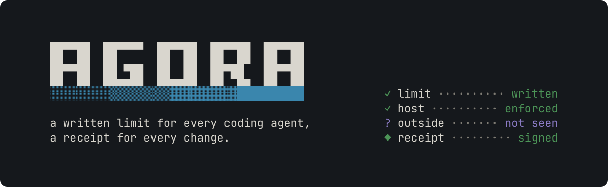

<p align="center">
  
</p>

> **Agora gives every coding agent a written limit and every agent-made change a receipt.**
> Local-first, open source, no account.

<p>
  <a href="https://www.npmjs.com/package/agora-hub"></a>
  <a href="https://github.com/IrgenSlj/agora/blob/main/LICENSE"></a>
  <a href="https://github.com/IrgenSlj/agora/actions"></a>
</p>

Coding agents now run for minutes or hours at a stretch. Nobody clicks through every approval
prompt for that long, so people either babysit the agent or switch the prompts off. Neither gives
you what you need: a limit you set up front, and proof afterwards that the agent stayed inside it.

Agora is that layer, and it works across hosts. You keep one policy file, `agora.cedar`, in the
repository. Agora will:

- **learn** a minimal policy from what your agents actually do in this repo,
- **compile** it into each host's own permission, sandbox and hook settings, and list every rule a
  host cannot enforce rather than dropping it quietly,
- **sign a receipt** for each agent session, attached to the commits it produced, so a reviewer
  can ask "was this change made within policy?" and CI can answer.

> **Status: Agora 2.0 is being built on `main` and is not released yet.** npm still has 0.8. The
> table below says what works on `main` today, and it is kept honest against the code.

## Status

| Capability | State |
|---|---|
| `agora hook` — Claude Code hooks that deny calls to revoked MCP servers and record each session | **Works** |
| `agora run` / `agora observe` — record MCP tool calls and sampled network peers, never arguments or results | **Works** |
| `agora audit` — look up every configured MCP server in OSV.dev | **Works** |
| `agora receipt` — a receipt per commit in git notes, naming the agent sessions that produced it and what they touched; signed with a key that lives only in the OS keychain | **Works** |
| `agora ci` and the GitHub Action — verify every commit's receipt in a pull request, and fail on a blocking advisory | **Works** |
| `agora learn` and `agora replay` — propose a least-privilege `agora.cedar` from what agents did, and see what a policy would have denied | **Works** |
| `agora plan` / `apply` — compile `agora.cedar` into Claude Code: the hook enforces it on every tool call, exact permits become allow rules | **Works** (Claude Code) |
| `agora doctor` — what Agora can see and enforce on this machine | **Works** |
| `agora log` and the recording hooks — a hash-chained, tamper-evident log of every tool call, file touched, program run and host fetched | **Works** |
| OpenCode support and canary files (phase 4) | Planned |
| Runner-signed receipts and the evidence report (phase 5, release 2.0.0) | Planned |

The full plan, with a runnable gate for each phase, is in [`docs/PLAN.md`](./docs/PLAN.md).

## Try it

```console
$ npx -y agora-hub doctor

Hosts
  ✓ Claude Code · 3 MCP servers
  ✓ Cursor · 1 MCP server
  · VS Code · not found

Enforcement
  ⚠ Claude Code hook not installed · run `agora hook install`
  ⚠ no agora.cedar · run `agora policy init`

Revocations
  ✓ no configured server is on the revocation list (4 checked)
```

```bash
agora hook install     # deny revoked MCP servers and record every session
agora log show         # the last session as a timeline; `agora log verify` checks the chain
agora learn --apply    # write agora.cedar from what agents actually did here
agora replay           # what that policy would have denied in past sessions
agora apply            # compile it into .claude/settings.json; the hook enforces it
agora signer init      # a signing key in your OS keychain; `agora signer trust` lists it here
agora receipt write    # after a commit: record how agents produced it, as a git note
git push origin refs/notes/agora
agora policy init      # scaffold agora.cedar at the repository root
agora audit            # look every configured server up in OSV.dev
```

Every command takes `--json` and uses the same exit codes: `0` clean, `1` policy failure, `2` usage,
`3` could not check.

## Put it in CI

```yaml
- uses: actions/checkout@v4
  with:
    fetch-depth: 0
- uses: IrgenSlj/agora@v0
  with:
    require-signer: none       # or local-keychain
    fail-on-unknown: false     # true: a commit without a receipt fails the build
```

This verifies the receipt on every commit of the pull request, against signing keys trusted at the
pull request's base, and lists each commit with what its agent sessions did in the job summary. A
commit without a receipt is reported as not established, never as a pass. It also fails the build
when an MCP server the repository configures has a malware, critical or high advisory.

## What Agora will never do

- **Grant a permission you did not write.** The hook can deny or stay silent; it never says
  "allow". `agora apply` writes allow rules only as exact copies of permits in your own
  `agora.cedar`, and removes them when the permit goes.
- **Block your agent because Agora broke.** Hooks fail open and say so on stderr. CI fails closed.
- **Record what your agent read or wrote.** Events hold tool names, paths, commands and peers, never
  arguments, results, prompts or file contents.
- **Turn unknown into clean.** A check that did not run is reported as not established.
- **Score anything, or call it safe.** Agora states what it checked and what it could not.

## Upgrading from 0.8

2.0 removes everything outside this plan: search, install and acquire, the `agora.toml` stack
manager and lockfile, the pre-install scan, the daily digest and the agent-facing MCP server. Each
removed command still runs and tells you what happened:

```
$ agora search filesystem
`agora search` was removed in v2.0.0.
  Agora 2.0 narrowed to one job: a written limit for coding agents and a receipt for what
  they did. Finding and installing tools is left to the hosts and registries.
```

`plan` and `apply` are back with a new meaning: compiling `agora.cedar` into host settings. See
[`CHANGELOG.md`](./CHANGELOG.md) for the full list.

## Development

```bash
bun install
bun run typecheck && bun run lint && bun run test && bun run verify:package
bun src/cli.ts <cmd>   # run from source
```

Node ≥ 22.22.2, ESM only. Read [`AGENTS.md`](./AGENTS.md) for the rules, [`docs/PLAN.md`](./docs/PLAN.md)
for the plan and [`docs/STATUS.md`](./docs/STATUS.md) for what is built. Pull requests welcome; see
[`CONTRIBUTING.md`](./CONTRIBUTING.md).

## License

[MIT](./LICENSE) — © IrgenSlj.
