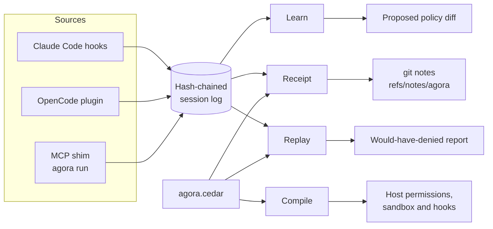
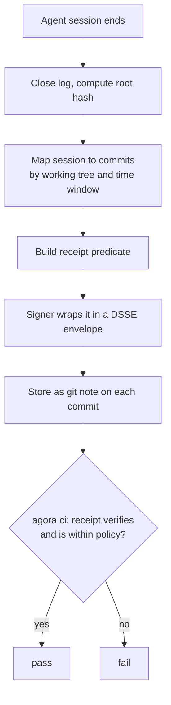
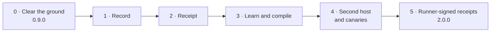

# Agora 2.0 — vision, architecture and build plan

This is the one plan. It was copied from the 2.0 brief on 2026-11-11 and replaces
`AGORA_BRIEF_v2.md`, `ROADMAP.md` and `docs/NEXT.md`. What is actually built is tracked in
[`STATUS.md`](./STATUS.md); rules for agents working on the code are in
[`../AGENTS.md`](../AGENTS.md).

## Vision

**Agora gives every coding agent a written limit and every agent-made change a receipt.**

Agora 0.x asked whether a tool artifact could be trusted. Agora 2.0 asks two questions that
survive remote servers, skills and longer-running agents: what is this agent allowed to do, and
what did it do?

Three beliefs drive the design:

- **Approval prompts are dying.** Agents run too long for a human to click through each action, so
  authority must be declared up front and proven afterwards.
- **Every host has its own permission format.** No host vendor will build the layer that works
  across all of them.
- **Agent-written code needs provenance.** A reviewer should see how a change was produced, not
  only what changed.

Agora stays local-first, open source, with no account. "Unknown stays unknown" remains the rule
everywhere a verdict is shown.

## Product

The product is three commands over one policy file, `agora.cedar`, committed to the repository.

| Function | Command | What the user gets |
|---|---|---|
| **Learn** | `agora learn` | A proposed minimal policy, synthesised from what agents did in this repo: tools, paths, commands, network peers. Shown as a diff; nothing is written without `--apply`. |
| **Compile** | `agora plan` / `agora apply` | The policy translated into each host's native permission, sandbox and hook configuration. Rules a host cannot enforce are listed as *not enforced*, never silently dropped. |
| **Receipt** | `agora receipt` / `agora ci` | A signed statement per session, bound to the commits it produced. CI answers one question: was this change made within policy? |

Two supporting features make the three safe to adopt:

- **Replay.** `agora replay --policy <file>` runs recorded sessions against a stricter policy and
  reports what would have been blocked, before anything is enforced.
- **Canaries.** `agora canary install` plants a decoy credential file and a decoy tool. Any touch
  is recorded in the receipt and denied by the hook.

Revocation remains as one deny-rule source for policy. It is no longer a product.

## Architecture

One event stream feeds everything: hosts and the MCP shim emit normalised events into a
tamper-evident log, and learn, compile, receipt and replay are all readers of that log plus the
policy file.



Sources only write events; functions only read the log and the policy. Nothing downstream talks
to a host directly except Compile, through the existing adapters.

### Module map

| Module | Responsibility | Status |
|---|---|---|
| `src/events/` | `AgentEvent` schema; one normaliser per source (Claude Code hooks, OpenCode plugin, MCP shim) | new |
| `src/log/` | Append-only, hash-chained JSONL per session; root hash on close | new |
| `src/policy/` | Cedar engine, entity model, schema for agent actions | kept, extended |
| `src/learn/` | Policy synthesis: generalise paths to globs, group commands, propose a diff | new |
| `src/compile/` | One emitter per host plus a capability matrix of what each host can enforce | new |
| `src/receipt/` | Predicate, builder, verification | new, builds on `evidence/dsse.ts` |
| `src/signer/` | Small separate process holding the key in the OS keychain | new |
| `src/hook/` | PreToolUse/PostToolUse: evaluate policy, emit events, deny only | kept, extended |
| `src/observe/` | Byte-transparent MCP shim | kept |
| `src/stack/adapters/` | Surgical, atomic host-config reads and writes | kept |
| `src/ci/` | Verify receipts against policy for the commits in a pull request | rewritten |

### Receipt flow



A commit with no receipt is a third outcome: `agora ci` reports it as *not established*, and
`--fail-on-unknown` turns that into a failure.

### Data models

**AgentEvent** (one JSON line):

```json
{
  "v": 1, "session": "01J...", "seq": 42, "ts": "2026-11-10T08:00:00Z",
  "host": "claude-code",
  "kind": "tool_call | file_read | file_write | exec | net | approval | canary",
  "subject": "mcp:github/create_issue | src/app.ts | git | api.github.com:443",
  "decision": "allowed | denied | asked",
  "prev": "sha256:...", "hash": "sha256:..."
}
```

Events never contain tool arguments, results, prompt text or file contents. Paths inside the
repository are stored relative; paths outside are stored as a class (`home`, `system`, `tmp`) only.

**Receipt** (in-toto statement in a DSSE envelope, stored as a git note under `refs/notes/agora`):

```json
{
  "subject": [{ "name": "git:commit", "digest": { "gitCommit": "<sha>" } }],
  "predicateType": "https://github.com/IrgenSlj/agora/receipt/v1",
  "predicate": {
    "sessions": [{ "id": "01J...", "host": "claude-code", "log_root": "sha256:..." }],
    "policy_sha256": "sha256:...",
    "servers": [{ "name": "github", "purl": "pkg:npm/...", "tools_digest": "sha256:..." }],
    "touched": { "paths": ["src/**"], "commands": ["git", "bun"], "peers": ["api.github.com:443"] },
    "denied": 0, "canary_hits": 0,
    "not_enforced": ["network egress (host has no network control)"],
    "signer": "none | local-keychain | runner-oidc"
  }
}
```

**Signer levels.** The receipt states its own strength:

| Level | Who signs | What it proves |
|---|---|---|
| `none` | nobody | A self-reported log. Useful for review, forgeable by the agent. |
| `local-keychain` | The signer process, key outside the agent's sandbox | The log was not rewritten after the fact by a sandboxed agent. |
| `runner-oidc` | A CI or remote-sandbox runner via Sigstore keyless | The session ran on that runner; the developer's machine is out of the trust base. |

### Keep, cut, add

Done in phase 0. Everything removed is listed in `src/cli/retired.ts`, so old commands explain
themselves.

| Kept | Cut | Added later |
|---|---|---|
| `stack/adapters/*`, `atomic-write.ts`, `stack/transaction.ts` | `federation/`, `search/`, `catalog/` | `events/`, `log/` |
| `observe/*` (shim, frame tee) | `news/`, `hubs/`, `today`, `browse`, `marketplace` | `learn/` |
| `hook/*` | `scan.ts` regex heuristics | `compile/` |
| `gate/authorization.ts` (decision kernel) | `acquire.ts`, `try`, `sync`, `serve/` | `receipt/`, `signer/` |
| `policy/engine.ts`, `policy/entities.ts` | `store/` (SQLite) and `better-sqlite3` | `replay`, `canary` |
| `evidence/dsse.ts`, `model/attestation.ts`, `model/hash.ts`, `model/purl.ts` | `lock`, the stack manager | Receipt-based `ci/` |
| `revocation/*` as a deny-rule source | The OSV feed sync workflow and `feed/` as a published product | |

## Build plan

Six phases, each ending in a gate that is a runnable check, not an opinion. A phase does not start
until the previous gate passes. Claude Code is the only host until phase 4.



### Phase 0 — Clear the ground (release 0.9.0)

- [x] Fix the feed: emit OSV `versions` as explicit lists; add a test that popular servers at
      current versions are not blocked
- [x] Replace `compareVersions` with the `semver` package; fix `pkg@tag` purl parsing
- [x] Retire the cut list through `retired.ts`; delete the modules; remove `better-sqlite3`
- [x] Rewrite README to the new promise; mark everything not yet built as planned
- [ ] Set up npm trusted publishing; publish 0.9.0; create the `v0` tag

**Gate:** `bun run verify:package` is green, `src/` is under 11,000 lines, and
`npx -y agora-hub@0.9.0 doctor` runs on a clean machine.

### Phase 1 — Record

- [ ] `AgentEvent` zod schema and JSON Schema export
- [ ] Hash-chained session log under the data directory; `agora log verify`
- [ ] Claude Code `PreToolUse` and `PostToolUse` hooks emit events; the MCP shim emits `tool_call`
      events
- [ ] `agora log show` renders a session as a readable timeline

**Gate:** a real session yields a chain that verifies; changing any byte of the log fails
verification; hook overhead stays under 100 ms per call.

Open questions to settle here: whether Claude Code's hooks expose enough to record file reads and
network peers, or only tool calls; and which key store the signer uses on Linux without a desktop
keyring.

### Phase 2 — Receipt

- [ ] Receipt predicate and builder; map sessions to commits by time window and working tree
- [ ] Store and fetch via `refs/notes/agora`; `agora receipt show <commit>`
- [ ] `agora ci` verifies receipts for a pull request's commits and writes a job summary
- [ ] Signer process with an OS-keychain key; receipts report their signer level

**Gate:** a pull request on Agora's own repository shows a receipt summary in CI, and a tampered
receipt or log turns the check red.

### Phase 3 — Learn and compile

- [ ] Cedar schema for agent actions (tool, path, command, peer)
- [ ] `agora learn`: synthesise a minimal policy from logged sessions, as a reviewable diff
- [ ] Claude Code emitter: policy to native permissions plus hook enforcement; capability matrix
      lists gaps
- [ ] `agora replay --policy`: report what a policy would have denied

**Gate:** on Agora's own repository, a policy learned from one week of sessions denies zero
legitimate actions in replay, and the count of approval prompts per session drops measurably.

### Phase 4 — Second host and canaries

- [ ] OpenCode normaliser and emitter (its plugin API has a tool-call boundary)
- [ ] `agora canary install`: decoy credential file and decoy tool; hits are denied and recorded
- [ ] Receipts carry `not_enforced` per host

**Gate:** one policy file compiles to both hosts, and each host's enforcement gaps appear in
`agora plan` and in the receipt.

### Phase 5 — Runner-signed receipts and the evidence report (release 2.0.0)

- [ ] GitHub Action mode that signs receipts with Sigstore keyless via the runner's OIDC identity
- [ ] `agora report`: a static evidence report for a repository and date range, built from its
      receipts
- [ ] Public profile registry repository: minimal policies per MCP server, contributed by pull
      request

**Gate:** a stranger can verify a runner-signed receipt with only the public repository, and the
report renders from git notes with no server.

## Risks and known limits

| Risk | Consequence | Response |
|---|---|---|
| Local receipts are self-attested | An agent with shell access can forge an unsigned receipt | Signer levels are explicit; `agora ci` can require `runner-oidc` |
| Hosts change hook and permission formats | Emitters break silently | Capability matrix tests run against recorded fixtures per host version; AGENTS.md rule 7 |
| Hosts standardise permissions themselves | The compiler loses value | Agora becomes the reference implementation; receipts and learn still stand |
| Session-to-commit mapping is ambiguous | A receipt is attached to the wrong commit | Bind by working tree and time window; report ambiguity as unknown instead of guessing |
| Learned policies overfit | Legitimate work is blocked after enforcement | Replay before apply; hooks deny with a message naming the rule and the fix |
| Nearby tools exist (local audit logs, host telemetry) | The log alone is not differentiating | The combination of synthesis, cross-host compilation and commit-bound receipts is the product; do not ship the log as the headline |
