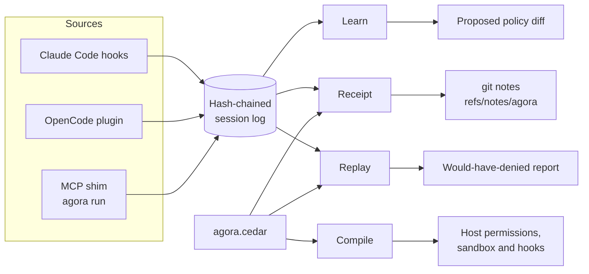
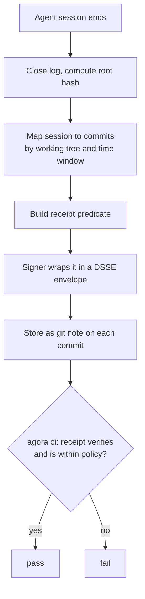
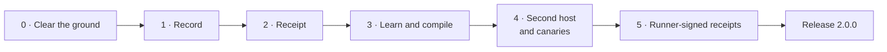

# Agora 2.0 — vision, architecture and build plan

This is the one plan. It was copied from the 2.0 brief on 2026-11-11 and replaces
`AGORA_BRIEF_v2.md`, `ROADMAP.md` and `docs/NEXT.md`. What is actually built is tracked in
[`STATUS.md`](./STATUS.md); rules for agents working on the code are in
[`../AGENTS.md`](../AGENTS.md).

## Vision

**Agora gives every coding agent a written limit and every agent-made change a receipt.**

Agora 0.x asked whether a tool artifact could be trusted. Agora 2.0 asks two questions that
survive remote servers, skills and longer-running agents: what is this agent allowed to do, and
what did it do?

Three beliefs drive the design:

- **Approval prompts are dying.** Agents run too long for a human to click through each action, so
  authority must be declared up front and proven afterwards.
- **Every host has its own permission format.** No host vendor will build the layer that works
  across all of them.
- **Agent-written code needs provenance.** A reviewer should see how a change was produced, not
  only what changed.

Agora stays local-first, open source, with no account. "Unknown stays unknown" remains the rule
everywhere a verdict is shown.

## Product

The product is three commands over one policy file, `agora.cedar`, committed to the repository.

| Function | Command | What the user gets |
|---|---|---|
| **Learn** | `agora learn` | A proposed minimal policy, synthesised from what agents did in this repo: tools, paths, commands, network peers. Shown as a diff; nothing is written without `--apply`. |
| **Compile** | `agora plan` / `agora apply` | The policy translated into each host's native permission, sandbox and hook configuration. Rules a host cannot enforce are listed as *not enforced*, never silently dropped. |
| **Receipt** | `agora receipt` / `agora ci` | A signed statement per session, bound to the commits it produced. CI answers one question: was this change made within policy? |

Two supporting features make the three safe to adopt:

- **Replay.** `agora replay --policy <file>` runs recorded sessions against a stricter policy and
  reports what would have been blocked, before anything is enforced.
- **Canaries.** `agora canary install` plants a decoy credential file and a decoy tool. Any touch
  is recorded in the receipt and denied by the hook.

Revocation remains as one deny-rule source for policy. It is no longer a product.

## Architecture

One event stream feeds everything: hosts and the MCP shim emit normalised events into a
tamper-evident log, and learn, compile, receipt and replay are all readers of that log plus the
policy file.



Sources only write events; functions only read the log and the policy. Nothing downstream talks
to a host directly except Compile, through the existing adapters.

### Module map

| Module | Responsibility | Status |
|---|---|---|
| `src/events/` | `AgentEvent` schema; one normaliser per source (Claude Code hooks, OpenCode plugin, MCP shim) | new |
| `src/log/` | Append-only, hash-chained JSONL per session; root hash on close | new |
| `src/policy/` | Cedar engine, entity model, schema for agent actions | kept, extended |
| `src/learn/` | Policy synthesis: generalise paths to globs, group commands, propose a diff | new |
| `src/compile/` | One emitter per host plus a capability matrix of what each host can enforce | new |
| `src/receipt/` | Predicate, builder, verification | new, builds on `evidence/dsse.ts` |
| `src/signer/` | Small separate process holding the key in the OS keychain | new |
| `src/hook/` | PreToolUse/PostToolUse: evaluate policy, emit events, deny only | kept, extended |
| `src/observe/` | Byte-transparent MCP shim | kept |
| `src/stack/adapters/` | Surgical, atomic host-config reads and writes | kept |
| `src/ci/` | Verify receipts against policy for the commits in a pull request | rewritten |

### Receipt flow



A commit with no receipt is a third outcome: `agora ci` reports it as *not established*, and
`--fail-on-unknown` turns that into a failure.

### Data models

**AgentEvent** (one JSON line):

```json
{
  "v": 1, "session": "01J...", "seq": 42, "ts": "2026-11-10T08:00:00Z",
  "host": "claude-code",
  "kind": "tool_call | file_read | file_write | exec | net | approval | canary",
  "subject": "mcp:github/create_issue | src/app.ts | git | api.github.com:443",
  "decision": "allowed | denied | asked",
  "prev": "sha256:...", "hash": "sha256:..."
}
```

Events never contain tool arguments, results, prompt text or file contents. Paths inside the
repository are stored relative; paths outside are stored as a class (`home`, `system`, `tmp`) only.

**Receipt** (in-toto statement in a DSSE envelope, stored as a git note under `refs/notes/agora`):

```json
{
  "subject": [{ "name": "git:commit", "digest": { "gitCommit": "<sha>" } }],
  "predicateType": "https://github.com/IrgenSlj/agora/receipt/v1",
  "predicate": {
    "sessions": [{ "id": "01J...", "host": "claude-code", "log_root": "sha256:..." }],
    "policy_sha256": "sha256:...",
    "servers": [{ "name": "github", "purl": "pkg:npm/...", "tools_digest": "sha256:..." }],
    "touched": { "paths": ["src/**"], "commands": ["git", "bun"], "peers": ["api.github.com:443"] },
    "denied": 0, "canary_hits": 0,
    "not_enforced": ["network egress (host has no network control)"],
    "signer": "none | local-keychain | runner-oidc"
  }
}
```

**Signer levels.** The receipt states its own strength:

| Level | Who signs | What it proves |
|---|---|---|
| `none` | nobody | A self-reported log. Useful for review, forgeable by the agent. |
| `local-keychain` | The signer process, key outside the agent's sandbox | The log was not rewritten after the fact by a sandboxed agent. |
| `runner-oidc` | A CI or remote-sandbox runner via Sigstore keyless | The session ran on that runner; the developer's machine is out of the trust base. |

### Keep, cut, add

Done in phase 0. Everything removed is listed in `src/cli/retired.ts`, so old commands explain
themselves.

| Kept | Cut | Added later |
|---|---|---|
| `stack/adapters/*`, `atomic-write.ts`, `stack/transaction.ts` | `federation/`, `search/`, `catalog/` | `events/`, `log/` |
| `observe/*` (shim, frame tee) | `news/`, `hubs/`, `today`, `browse`, `marketplace` | `learn/` |
| `hook/*` | `scan.ts` regex heuristics | `compile/` |
| `gate/authorization.ts` (decision kernel) | `acquire.ts`, `try`, `sync`, `serve/` | `receipt/`, `signer/` |
| `policy/engine.ts`, `policy/entities.ts` | `store/` (SQLite) and `better-sqlite3` | `replay`, `canary` |
| `evidence/dsse.ts`, `model/attestation.ts`, `model/hash.ts`, `model/purl.ts` | `lock`, the stack manager | Receipt-based `ci/` |
| `revocation/*` as a deny-rule source | The OSV feed sync workflow and `feed/` as a published product | |

## Build plan

Six phases, each ending in a gate that is a runnable check, not an opinion. The plan is a list of
steps, not a schedule: work moves on when a gate passes, and the steps are done in sessions as time
allows. Claude Code is the only host until phase 4.

**One release.** Nothing is published until every phase and idea in this plan is built; then
2.0.0 ships once. Until then `main` is the product and npm stays at 0.8.



### Phase 0 — Clear the ground

- [x] Fix the feed: emit OSV `versions` as explicit lists; add a test that popular servers at
      current versions are not blocked
- [x] Replace `compareVersions` with the `semver` package; fix `pkg@tag` purl parsing
- [x] Retire the cut list through `retired.ts`; delete the modules; remove `better-sqlite3`
- [x] Rewrite README to the new promise; mark everything not yet built as planned
- [x] npm trusted publishing is set up; publishing waits for the single release

**Gate passed:** `bun run verify:package` is green, the packed tarball runs `agora doctor` in an
empty directory, and `src/` was under 11,000 lines after the cut.

### Phase 1 — Record

- [x] `AgentEvent` zod schema and JSON Schema export
- [x] Hash-chained session log under the data directory; `agora log verify`
- [x] Claude Code `PreToolUse` and `PostToolUse` hooks emit events; the MCP shim emits `tool_call`
      events
- [x] `agora log show` renders a session as a readable timeline

**Gate:** a real session yields a chain that verifies; changing any byte of the log fails
verification; hook overhead stays under 100 ms per call.

**Gate passed 2026-11-11.** A headless Claude Code session in a scratch repository, with the hooks
installed, produced a closed five-event chain that verifies; a one-character edit fails it; the
recorder costs 72 ms per call against Node's 60 ms startup.

Settled: Claude Code hooks expose every built-in tool's input, so file reads, writes, programs and
fetched hosts are recorded; peers contacted by a shell command (`curl`) are not visible. Also
recorded: `SessionStart`, `SessionEnd` and `PermissionDenied`, and a `session` event kind for start
and end markers. Still open, for phase 2: which key store the signer uses on Linux without a
desktop keyring.

### Phase 2 — Receipt

- [x] Receipt predicate and builder; map sessions to commits by time window and working tree
- [x] Store and fetch via `refs/notes/agora`; `agora receipt show <commit>`
- [x] `agora ci` verifies receipts for a pull request's commits and writes a job summary
- [x] Signer process with an OS-keychain key; receipts report their signer level

**Gate:** a pull request on Agora's own repository shows a receipt summary in CI, and a tampered
receipt or log turns the check red.

**Gate passed 2026-11-11** on PR #73, closed unmerged as planned. A headless Claude Code session made
the commit with the hooks installed. Its receipt verified in the self-check run, and the rerun
failed after a forged receipt (claiming a signature it did not carry) was pushed. `receipt write`
refuses to summarise a log that does not verify.

How it was built, where it differs from the sketch above:

- Sessions bind to a commit when they ran in the same working tree, which the hooks record in a
  local, unpublished metadata file, and have events after the parent commit and up to this one.
- `touched` lists files written and read, programs, peers and MCP tools, each capped at 200.
- Signing runs in-process, not in a separate signer process: a second process for the same user
  adds no isolation. The key exists only in the macOS Keychain or the Linux Secret Service.
  Without either, receipts stay `signer none`, which settles the Linux question until runner
  signing in phase 5.
- CI trusts keys from `.agora/signers.json` at the base of the range, so a pull request cannot add
  the key that vouches for it. `--require-signer` rejects receipts below a level.

### Phase 3 — Learn and compile

- [x] Cedar schema for agent actions (tool, path, command, peer)
- [x] `agora learn`: synthesise a minimal policy from logged sessions, as a reviewable diff
- [x] Claude Code emitter: policy to native permissions plus hook enforcement; capability matrix
      lists gaps
- [x] `agora replay --policy`: report what a policy would have denied

**Gate:** on Agora's own repository, a policy learned from at least 20 real sessions denies zero
legitimate actions when replayed against the next 10, and those 10 sessions ask for fewer
approvals than the 20 before the policy was applied.

**Gate open.** The code is in, and the loop works end to end on a real session: in a scratch
repository, `agora learn --apply` and a tightened rule made `agora replay` predict a denial of
`curl`, and a headless Claude Code session that was itself allowed to run `curl` was stopped by
the hook with the policy's reason, the denial recorded in the log. The gate needs real sessions on this
repository, which needs the hooks installed here and `agora` on PATH.

Decisions made while building it:

- **Rule 3 and allow rules.** The hook never allows. `agora apply` writes `permissions.allow` rules
  only as exact copies of permits in the repository's own `agora.cedar`, written by a person
  running `apply`, and tracks them in `.agora/compiled.json` so they leave when the permit does.
  That is the only grant Agora writes, and it is what makes prompts drop.
- **Enforcement is the hook.** Claude Code runs PreToolUse hooks before its own permission check,
  and a hook's deny holds against an allow rule, so the hook evaluates `agora.cedar` exactly.
  Allow rules are compiled only from shapes with an exact equivalent; everything else is listed as
  enforced by the hook only.
- **Learn generalises to the top-level directory** and no further, and flags any permission outside
  the repository for review.
- **Cost.** Checking a call against a policy takes about 130 ms per tool call, about 45 ms of it
  Cedar. A long-lived evaluator or a compiled matcher can cut that if it matters.

### Phase 4 — Second host and canaries

- [x] OpenCode normaliser and emitter (its plugin API has a tool-call boundary)
- [x] `agora canary install`: decoy credential file and decoy tool; hits are denied and recorded
- [x] Receipts carry `not_enforced` per host

**Gate:** one policy file compiles to both hosts, and each host's enforcement gaps appear in
`agora plan` and in the receipt.

Started while the phase 3 gate collects real sessions: that gate waits on use, not on code.

**Gate passed 2026-11-12.** In a scratch repository using both hosts, one `agora.cedar` compiled to
Claude Code settings and the OpenCode plugin, and `agora plan` listed each host's gaps. A live
OpenCode session was denied `curl` by the policy, then hit the canary file and the decoy tool;
the commit's receipt verified, counted three denials and two canary hits, and listed OpenCode's
gaps under "not seen". Receipts now list only what ran: denied calls are counted, not touched.

How OpenCode works, checked against a live OpenCode 1.19.3 session on 2026-11-12:

- `agora apply` writes `.opencode/plugins/agora.js` when the repository uses OpenCode. The plugin
  sends each tool call to `agora hook check` before it runs and `agora hook record` after, so one
  engine evaluates one policy for both hosts. A deny throws, and OpenCode shows the reason to the
  agent. If `agora` is missing or fails, the call proceeds.
- No allow rules are compiled for OpenCode: it allows everything by default, so there is no prompt
  for a permit to remove.
- MCP tools in OpenCode are named `<server>_<tool>`, which cannot be split reliably, so the
  revocation list does not reach them. Approval prompts are not recorded yet.

Canaries, checked the same way:

- `agora canary install` plants fresh fake keys in `.env.production.local`, hidden by
  `.git/info/exclude`. `--tool` adds a decoy MCP tool, `deploy-vault/get_deploy_credentials`:
  in Claude Code's local scope for this repository (never committed), and in the OpenCode plugin.
- The hook denies a tool call on the file, a shell command that names it, or a call to the decoy
  tool, and records a `canary` event. Receipts count hits; `agora ci` fails on them.
- Not seen: a program that opens the file without naming it (a script, `cat .env*`).

### Phase 5 — Runner-signed receipts and the evidence report

- [ ] GitHub Action mode that signs receipts with Sigstore keyless via the runner's OIDC identity
- [x] `agora report`: a static evidence report for a repository and date range, built from its
      receipts
- [ ] Public profile registry repository: minimal policies per MCP server, contributed by pull
      request

**Gate:** a stranger can verify a runner-signed receipt with only the public repository, and the
report renders from git notes with no server.

How runner signing works:

- On a GitHub Actions runner with `permissions: id-token: write`, `agora receipt write` signs with
  Sigstore keyless as the running workflow. The note holds the Sigstore bundle; its certificate
  names the workflow, and Rekor logs the signature publicly.
- `agora signer trust --workflow agent.yml` adds that workflow's identity to `.agora/signers.json`.
  Verification checks the bundle against Sigstore's public trust root and that identity, read from
  the pull request base like keys are.
- New runtime dependency, `sigstore` (v5, pure JavaScript, maintained by the Sigstore and npm
  teams): Fulcio certificates, Rekor entries and bundle verification are security code that should
  not be rewritten. It is imported only when a receipt is runner-signed or verified.


## Pitch and business case (agreed 2026-11-11)

**Pitch.** Coding agents now open pull requests on their own. Tools already record what an agent
said; none shows that it stayed inside a limit. Agora does. It learns a written limit from how your
agents already work, enforces it in each agent host, and attaches a signed receipt to every commit,
which CI checks: within policy, or not. It stores no prompts and no code, so a receipt can be
published. Free and local for developers; teams pay for one policy across all their repositories
and for evidence an auditor can read.

**The proof point.** The phase 3 gate is the demo: zero legitimate actions denied, and fewer
approval prompts than before. Do not pitch to investors before that number exists from real use.

**Market, honestly.**

- The need is validated. Entire (former GitHub CEO, $60M seed, February 2026) records agent
  sessions in git. GitHub ships an `Agent-Logs-Url` trailer on Copilot commits and enterprise-managed
  agent permissions (September 2026). Kosli and JFrog are adding agent evidence to their products.
- **Where Agora is different:** others record the conversation. Agora proves the agent stayed inside
  a limit. It does this across hosts, with no content captured, and with a CI verdict. Each host
  vendor governs only its own agent.
- Regulation is a tailwind, not the reason to buy. Most coding assistants are not high-risk under
  the AI Act. Never sell compliance (see Law and regulation).

**Who pays.** Platform and security teams at companies that run agents in more than one host. They
pay for:

- one policy across all their repositories;
- receipts signed by their CI runner;
- the evidence report;
- support.

The CLI stays free, open source and account-free.

**Other outcomes.** Agora's receipts are in-toto attestations, so provenance platforms can consume
them. Kosli, JFrog and Entire could each become a partner or a buyer, not only a competitor.

**Risks to the case.**

- Host vendors or Entire add learned limits themselves.
- Agora is one founder with no users yet.
- A paid tier makes Agora a manufacturer under the Cyber Resilience Act.

Answer: ship the free tool, earn the gate number, and get real teams using it before charging.

## Law and regulation (checked 2026-11-11; re-check before the release)

Agora is not an AI system; it records and limits what coding agents do. What applies:

| Law | Status now | What it means for Agora |
|---|---|---|
| EU AI Act | Prohibitions, AI literacy, general-purpose model rules and Article 50 transparency apply. The Digital Omnibus (Regulation (EU) 2026/1744, in force 27 July 2026) moved stand-alone high-risk obligations to 2 December 2027 and product-embedded ones to 2 August 2028. | Most coding assistants are not high-risk. Where a team must keep records of AI use, Agora's logs and receipts are evidence. Never claim they make anyone compliant. |
| Cyber Resilience Act | Manufacturers must report actively exploited vulnerabilities from 11 September 2026; open-source stewards from 11 December 2027; full obligations from 11 December 2027. | Free, non-commercial Agora is not a manufacturer. A paid team layer would make it one. Keep a private vulnerability channel (SECURITY.md) and a fix process now. |
| GDPR | Applies to personal data. | Logs stay on the user's machine. Published receipts carry random session ids, repository paths, program names and timestamps, nothing else. Keep it that way; never add user names, emails or home paths. |

Sources: [Digital Omnibus on AI](https://artificialintelligenceact.eu/ai-act-explorer/digital-omnibus/),
[Freshfields on the final Omnibus](https://www.freshfields.com/en/our-thinking/blogs/technology-quotient/eu-ai-act-unpacked-34-the-final-digital-omnibus-on-ai-key-amendments-to-the-a-102nber),
[Commission: CRA reporting](https://digital-strategy.ec.europa.eu/en/policies/cra-reporting),
[OpenSSF on the 11 September deadline](https://openssf.org/blog/2026/09/11/a-community-guide-to-the-eu-cra-september-11-deadline-for-manufacturers/).

## Risks and known limits

| Risk | Consequence | Response |
|---|---|---|
| Local receipts are self-attested | An agent with shell access can forge an unsigned receipt | Signer levels are explicit; `agora ci` can require `runner-oidc` |
| Hosts change hook and permission formats | Emitters break silently | Capability matrix tests run against recorded fixtures per host version; AGENTS.md rule 7 |
| Hosts standardise permissions themselves | The compiler loses value | Agora becomes the reference implementation; receipts and learn still stand |
| Session-to-commit mapping is ambiguous | A receipt is attached to the wrong commit | Bind by working tree and time window; report ambiguity as unknown instead of guessing |
| Learned policies overfit | Legitimate work is blocked after enforcement | Replay before apply; hooks deny with a message naming the rule and the fix |
| Nearby tools exist (local audit logs, host telemetry) | The log alone is not differentiating | The combination of synthesis, cross-host compilation and commit-bound receipts is the product; do not ship the log as the headline |
